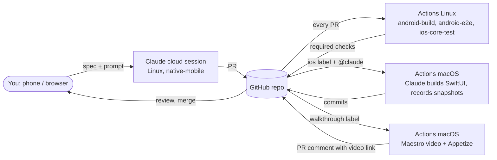

# How it works

A native mobile app (Kotlin + Jetpack Compose, Swift + SwiftUI) built almost entirely in the cloud at close to zero
cost. The owner steers from a phone or browser; nothing heavy runs on their own computer.

## Who does what, where

| Where | What runs there | Costs |
| --- | --- | --- |
| **Your phone or browser** | Write specs, start Claude cloud sessions, review PRs (screenshot diffs, the iOS video), merge | free |
| **Claude Code cloud session** (Linux VM, environment `native-mobile`) | All Kotlin/Android work, the Swift core (`AppCore`), drafting SwiftUI, opening PRs, Auto-fix on PRs | your Claude plan |
| **GitHub Actions, Linux** | `android.yml` (tests, screenshots, APK, Maestro on a KVM emulator), `ios-core.yml` (`swift test`) | free on a public repo |
| **GitHub Actions, macOS** | `ios-claude.yml` (Claude builds and fixes the SwiftUI app on a Mac), `ios-walkthrough.yml` (video of the app on an iPhone simulator) | free on a public repo; Claude runs use your Claude plan |
| **Appetize** | The iOS simulator build in a browser, to tap through | free: 30 min a month, 3-minute sessions |

## The workflows

| Workflow | Trigger | Jobs and what they do | Typical time |
| --- | --- | --- | --- |
| `android.yml` | every PR; pushes to `main` touching `android/`, `.maestro/` or the workflow | `changes` → `android-build` (unit tests, Roborazzi verify, debug APK as artifact) → `android-e2e` (API 36 emulator, every flow in `.maestro/`) | 1 + 3 min |
| `ios-core.yml` | every PR; pushes to `main` touching `ios/Packages/` or the workflow | `changes` → `ios-core-test` (`swift test` in the `swift:6.4-noble` container) | 1 min |
| `ios-walkthrough.yml` | PRs with the `walkthrough` label (and every push to them); pushes to `main` touching `ios/` or `.maestro/`; manual run | build the simulator app, boot iPhone 17, run every Maestro flow while recording, publish the video, upload to Appetize, comment on the PR | 12–15 min |
| `ios-claude.yml` | a comment containing `@claude` from an owner/member/collaborator, on a PR with the `ios` label | Claude Code on `macos-latest`: XcodeGen, `xcodebuild test`, look at snapshots, fix, re-record, commit to the PR branch | 40–55 min (cap 60 min, 120 turns) |

### Required checks and the `changes` job

`main` is protected by the ruleset **Protect main**: no deletion, no force-push, changes only through PRs, and three
required checks: `android-build`, `android-e2e`, `ios-core-test` (from GitHub Actions only).

A required check must report on every PR, or the PR waits forever. So `android.yml` and `ios-core.yml` run on every
PR, and a small `changes` job reads the PR's file list (`gh api repos/…/pulls/N/files`). When no relevant file
changed, the real jobs are skipped, and GitHub counts a skipped required check as passed. A docs-only PR therefore
merges in seconds. Pushes to `main` keep normal `paths:` filters.

**Never rename those three jobs** (`name:` in the workflow) without updating the ruleset: a renamed job leaves the old
required check waiting.

### Labels

| Label | Effect |
| --- | --- |
| `ios` | lets an `@claude` comment start a Mac run on that PR |
| `walkthrough` | records the iOS walk-through video on every push to that PR |

### Secrets and variables (names only; values live in GitHub → Settings → Secrets and variables → Actions)

| Name | Kind | Used by | Where it comes from |
| --- | --- | --- | --- |
| `CLAUDE_CODE_OAUTH_TOKEN` | secret | `ios-claude.yml` | `claude setup-token` (uses your Claude subscription) |
| `APPETIZE_API_TOKEN` | secret | `ios-walkthrough.yml` (optional; skipped when missing) | appetize.io → Account → API token |
| `APPETIZE_PUBLIC_KEY` | variable | `ios-walkthrough.yml` | the first upload's public key, so every build updates one Appetize app and keeps one link |

Parked: `FIREBASE_SERVICE_ACCOUNT` and `FIREBASE_APP_ID` for Firebase App Distribution ([../LATER.md](../LATER.md)).

### Outputs

- **Artifacts** (kept 3 days): `app-debug` (APK), `maestro-results` (Android), `test-reports` (on failure),
  `ios-walkthrough` (video, Maestro report and debug output, the zipped unsigned simulator `.app`).
- **The `walkthroughs` pre-release** holds the videos so they play in a browser: `pr-<N>-walkthrough.mp4` per PR and
  `main-walkthrough.mp4` for `main`. Each upload replaces the file of the same name.
- **One PR comment per walk-through**, starting with the hidden marker `<!-- ios-walkthrough -->`, updated in place on
  every run: video link, Appetize link, device, commit, result, run link.

## Screenshots: how UI is reviewed without a device

| | Android | iOS |
| --- | --- | --- |
| Tool | Roborazzi on Robolectric (JVM, no emulator) | swift-snapshot-testing in XCTest on the simulator |
| Runs on | Linux (cloud session and CI) | macOS only (Mac run) |
| Images | `android/app/src/test/snapshots/<Screen>_<state>_<light/dark>.png` | `ios/AppTests/__Snapshots__/ScreenshotTests/<test>.<light/dark>.png` |
| Record | `./gradlew :app:recordRoborazziDebug` | tests use `record: .missing`: delete the stale PNGs, run twice (the first run records and fails by design) |
| Verify | `./gradlew :app:verifyRoborazziDebug` (in CI) | `xcodebuild test` (Mac run) |

The images are committed, so every UI change shows up in the PR as an image diff (swipe view in the GitHub app).
iOS images depend on the runner image: the current ones were recorded on iPhone 17, iOS 26, Xcode 26.6.

## End-to-end flows: Maestro

`.maestro/*.yaml` are UI flows written once for both apps. Visible text is the contract: the flows tap and assert the
exact strings from the specs. `appId` comes from `-e APP_ID=…` (`com.myapp` on Android, `com.myapp.ios` on iOS).
Platform differences (Android system back vs. the iOS back button, which shows the previous screen's title) are
handled with `runFlow: when: platform:` blocks. Android runs them on every Android PR; iOS runs them in the
walk-through.

## Toolchain (pinned versions)

| Piece | Version | Pinned in |
| --- | --- | --- |
| JDK | 17 builds the app; 21 runs the unit tests (Robolectric needs it for SDK 36) | `app/build.gradle.kts`, workflows, `scripts/cloud-setup.sh` |
| Gradle / AGP / Kotlin | 9.9.2 / 9.5.2 / 2.4.21 | `gradle-wrapper.properties`, `gradle/libs.versions.toml` |
| Android SDK | compile/target 36, min 26, build-tools 36.0.0 | `app/build.gradle.kts`, `scripts/cloud-setup.sh` |
| Compose BOM | 2026.06.01 (newest that still compiles against SDK 36) | `gradle/libs.versions.toml` |
| Robolectric / Roborazzi | 4.18.1 / 1.79.0 | `gradle/libs.versions.toml` |
| Swift | 6.4.2 in the cloud environment; `swift:6.4-noble` in CI | `scripts/cloud-setup.sh`, `ios-core.yml` |
| Xcode / simulator | Xcode 26.6, iPhone 17, iOS 26 (whatever `macos-latest` has) | runner image |
| iOS deployment target | 17.0 | `ios/project.yml` |
| swift-snapshot-testing | from 1.19.7 | `ios/project.yml` |
| Maestro | 2.12.1 (release zip, not `curl \| bash`) | `android.yml`, `ios-walkthrough.yml` |
| XcodeGen | latest from Homebrew | Mac workflows |
| GitHub Actions | checkout v7, setup-java v6, setup-gradle v6, cache v6, upload-artifact v7, download-artifact v8 | workflows |

## Guardrails in every workflow

- `timeout-minutes` on every job; a `concurrency` group so a new push cancels the older run (except Mac Claude runs,
  which queue so a run that is committing snapshots isn't killed).
- Mac jobs start only by label or comment, and only for owners, members and collaborators.
- Gradle, SwiftPM and the emulator snapshot are cached; artifacts are kept 3 days.
- Secrets live only in GitHub secrets, never in code or in the cloud environment's variables.

## The feature loop

1. **Spec**: `specs/<feature>.md` from [`specs/_TEMPLATE.md`](../specs/_TEMPLATE.md): screens, states, exact texts,
   examples, acceptance checks.
2. **Android** in a cloud session: code, unit tests, Roborazzi images (the agent looks at them), Maestro flow, PR.
3. **iOS core** in a cloud session: `AppCore` logic with `swift test` on Linux; SwiftUI drafted (it can't compile on
   Linux). PR.
4. **Mac run** on the iOS PR: `ios` label + `@claude …` builds, fixes and records the snapshots.
5. **Walk-through**: `walkthrough` label for the video and the Appetize link.
6. **Review and merge**: image diffs, video, the spec's checklist ticked in the PR. Required checks green.

Exact prompts for each step are in [playbook.md](playbook.md).
